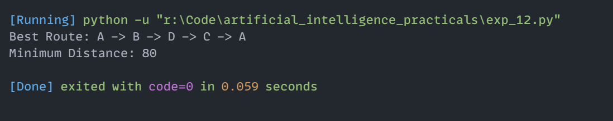

# Experiment 12: Traveling Salesperson Problem (TSP) using Permutations

## Aim
Implementation and demonstration of Traveling Salesperson Problem (TSP) using Permutations using Python.

## Program Information
- **File**: `exp_12.py`
- **Language**: Python 3
- **Libraries / Modules**: `itertools.permutations`

## Output

