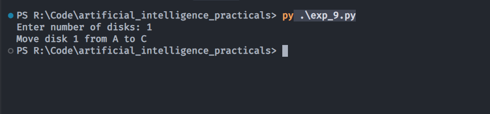

# Experiment 9: Tower of Hanoi Problem

## Aim
Implementation and demonstration of Tower of Hanoi Problem using Python.

## Program Information
- **File**: `exp_9.py`
- **Language**: Python 3
- **Libraries / Modules**: Standard Python Built-in

## Output

