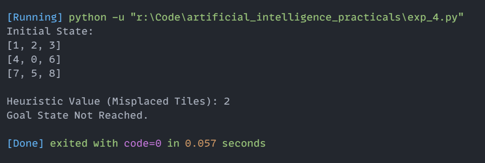

# Experiment 4: 8-Puzzle Problem using Heuristic Search (Misplaced Tiles)

## Aim
Implementation and demonstration of 8-Puzzle Problem using Heuristic Search (Misplaced Tiles) using Python.

## Program Information
- **File**: `exp_4.py`
- **Language**: Python 3
- **Libraries / Modules**: Standard Python Built-in

## Output

