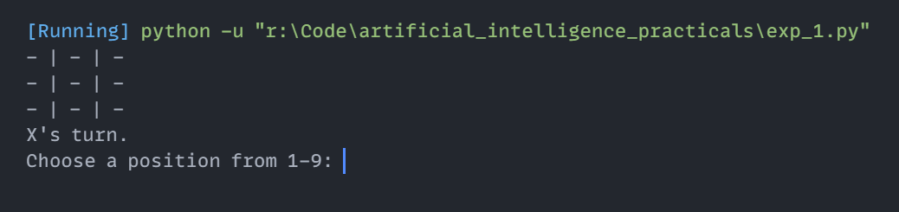

# Experiment 1: Tic-Tac-Toe Game (Two-Player)

## Aim
Implementation and demonstration of Tic-Tac-Toe Game (Two-Player) using Python.

## Program Information
- **File**: `exp_1.py`
- **Language**: Python 3
- **Libraries / Modules**: Standard Python Built-in

## Output

