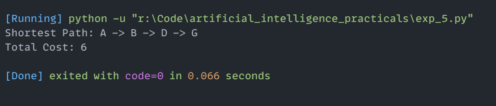

# Experiment 5: A* Search Algorithm

## Aim
Implementation and demonstration of A* Search Algorithm using Python.

## Program Information
- **File**: `exp_5.py`
- **Language**: Python 3
- **Libraries / Modules**: `heapq`

## Output

