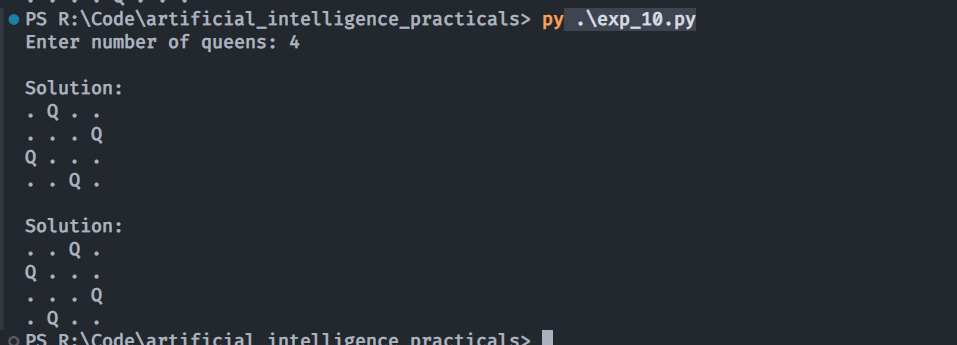

# Experiment 10: N-Queens Problem using Backtracking

## Aim
Implementation and demonstration of N-Queens Problem using Backtracking using Python.

## Program Information
- **File**: `exp_10.py`
- **Language**: Python 3
- **Libraries / Modules**: Standard Python Built-in

## Output

