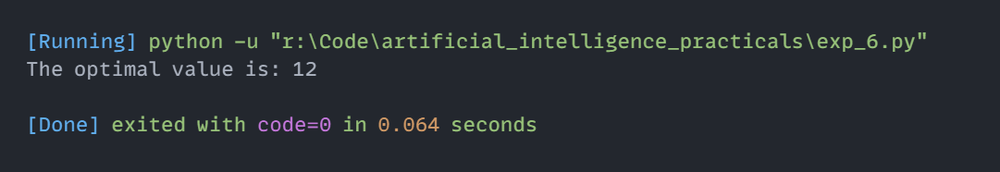

# Experiment 6: Mini-Max Search Algorithm

## Aim
Implementation and demonstration of Mini-Max Search Algorithm using Python.

## Program Information
- **File**: `exp_6.py`
- **Language**: Python 3
- **Libraries / Modules**: `math`

## Output

