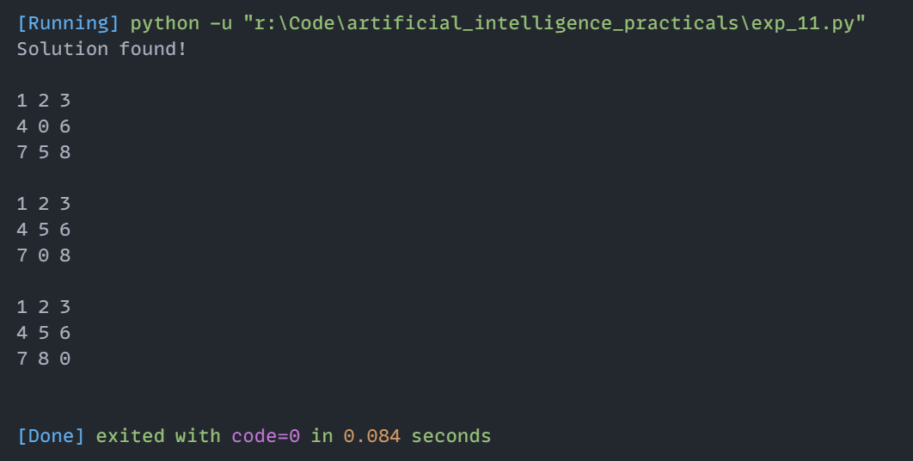

# Experiment 11: 8-Puzzle Problem using Breadth-First Search (BFS)

## Aim
Implementation and demonstration of 8-Puzzle Problem using Breadth-First Search (BFS) using Python.

## Program Information
- **File**: `exp_11.py`
- **Language**: Python 3
- **Libraries / Modules**: `collections.deque`

## Output

