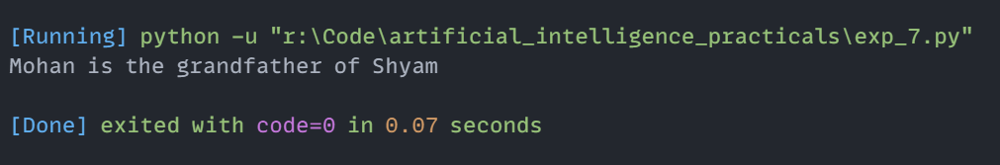

# Experiment 7: Knowledge Representation - Family Tree Relations (Grandfather)

## Aim
Implementation and demonstration of Knowledge Representation - Family Tree Relations (Grandfather) using Python.

## Program Information
- **File**: `exp_7.py`
- **Language**: Python 3
- **Libraries / Modules**: Standard Python Built-in

## Output

