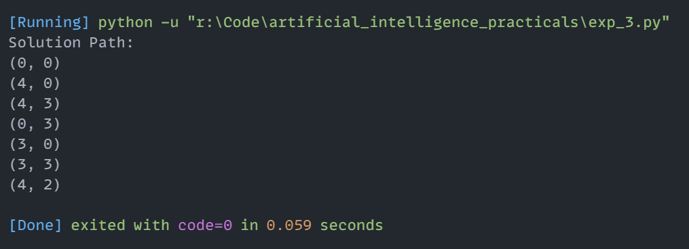

# Experiment 3: Water Jug Problem using Depth-First Search (DFS)

## Aim
Implementation and demonstration of Water Jug Problem using Depth-First Search (DFS) using Python.

## Program Information
- **File**: `exp_3.py`
- **Language**: Python 3
- **Libraries / Modules**: Standard Python Built-in

## Output

